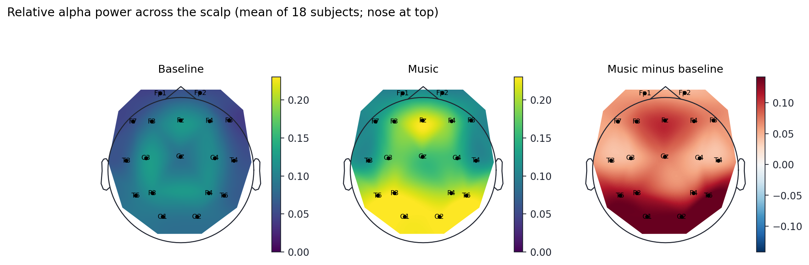
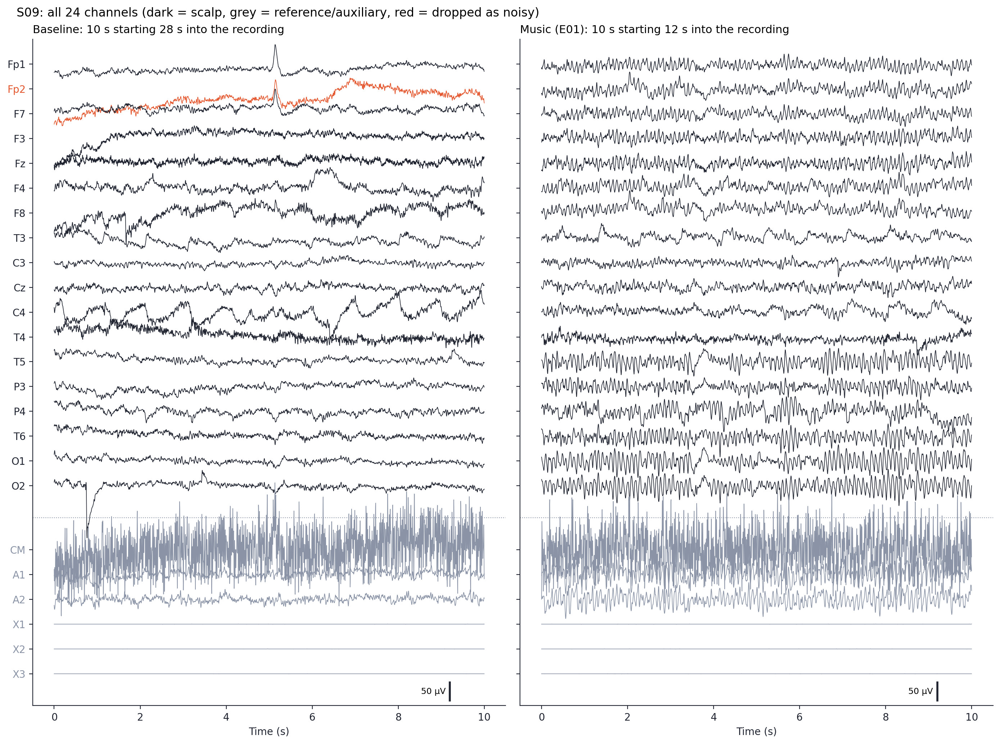
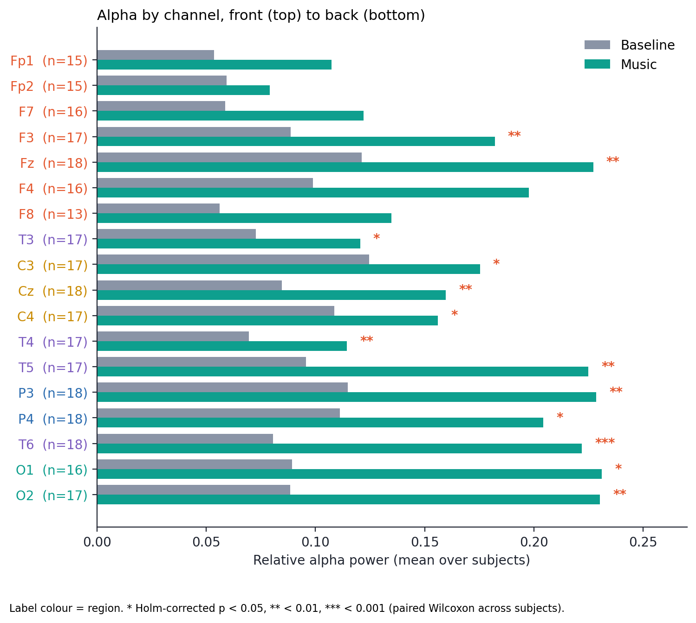
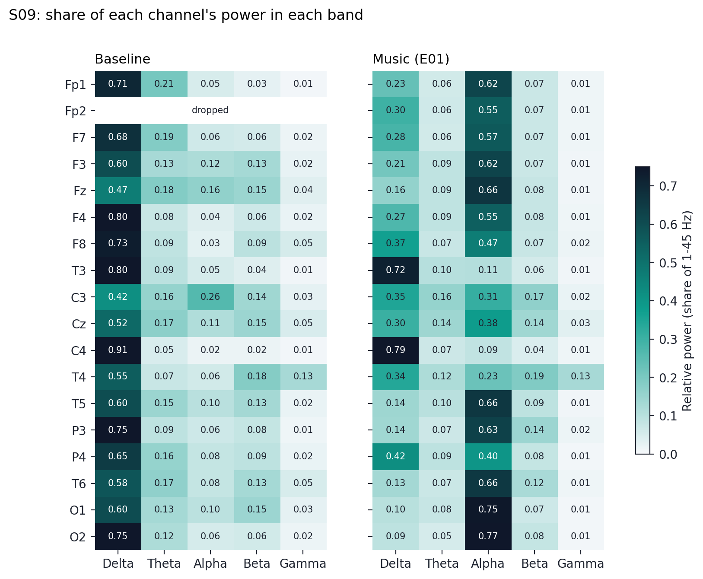
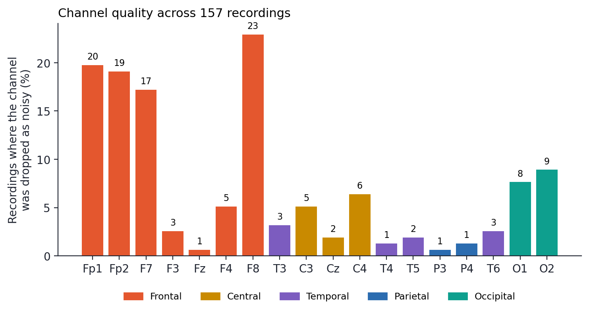

# EEG Channel Analysis

[](https://github.com/pranit432/EEG-Channel-Analysis/actions/workflows/tests.yml)

A channel-by-channel look at EEG recorded while people listen to music. Instead of averaging over the whole head, every sensor is plotted and compared separately, to show **where on the scalp** the brain activity changes, and which sensors can be trusted.

It includes the analysis code, the figures and result tables it produces, written observations, and an interactive Streamlit website for exploring any person and recording.

This project is separate from the whole-head band-power analysis and the EEG-to-music generator in [EEG-Music-Analysis](https://github.com/pranit432/EEG-Music-Analysis). It only **reads** the EEG files and writes everything into this folder.



## What it found

18 people, each with one baseline recording and several music-listening recordings (157 recordings used, 24 channels recorded, 18 of them scalp electrodes).

- **Alpha is higher during music at all 18 scalp channels,** and the rise is reliable (paired Wilcoxon, Holm-corrected over 18 channels) at **13** of them: F3, Fz, T3, C3, Cz, C4, T4, T5, P3, P4, T6, O1, O2.
- **It is strongest at the back of the head** (O1, O2 and T6 about +0.14 in relative alpha; T5 +0.13; P3 +0.11), with a **second hotspot at Fz** (+0.11). The pattern is left-right symmetric.
- **In one person (S09) the raw traces show it directly:** a steady wave about ten times a second over the back channels during music, and a 10.0 Hz peak in the spectrum, with no alpha peak at baseline.
- **The front channels are the weakest and the noisiest.** F8, Fp1, Fp2 and F7 were dropped as too noisy in 17-23% of recordings, so fewer people have usable data there. Fz and P3 were dropped in under 1%.
- **The change comes with a smaller share of delta,** mostly at the back of the head (occipital -0.12, parietal -0.09). The band shares add up to 1, so this is a shift in share, not proof that total activity rose.

### What it does not show
- **That the music caused it.** A back-of-head alpha peak is also the classic pattern of *closed eyes*, and the dataset does not say whether the baseline was recorded with eyes open or closed.
- **Anything about mood, attention or performance.** Only EEG was recorded.
- **That every person looks like the group.** Figures 1 and 2 use S09, whose change is the largest of the 18.

The full list, tied to each figure and number, is in [`observations.md`](observations.md).

## Figures

| | |
|---|---|
|  |  |
| **Raw traces** of all 24 channels, baseline next to music (S09) | **Alpha per channel**, baseline vs music, with significance stars |
|  |  |
| **Band power per channel:** each channel's share of delta, theta, alpha, beta, gamma (S09) | **Channel quality:** how often each channel was too noisy to use |

## How it works

1. **Load** each recording (EDF, 300 Hz, already band-pass filtered 1-50 Hz) with MNE.
2. **Crop** music trials to the span between the start and end markers stored in the file. Trials with less than 40 s of music are skipped.
3. **Separate the channels.** 18 scalp electrodes are analysed. The other six (CM, A1, A2 and X1-X3: a common-mode sense, two ear references and three flat auxiliary inputs) are not scalp electrodes and are left out.
4. **Remove noisy channels.** On an average-referenced signal, drop any channel whose standard deviation is more than 3 times the median, repeating up to 3 times, then average-reference over the channels kept.
5. **Window and reject.** Trim 2 s from each end, cut into 2 s windows, and reject any window where a kept channel swings more than 200 µV. Skip recordings with fewer than 8 clean windows.
6. **Band power per channel.** Welch spectrum of each window, averaged over windows, integrated over delta (1-4 Hz), theta (4-8), alpha (8-13), beta (13-30) and gamma (30-45). *Relative power* is a band's share of the channel's 1-45 Hz total.
7. **Compare baseline with music, per channel.** Each person's baseline against the mean of their own music trials, a two-sided paired Wilcoxon test across people, Holm-corrected over the 18 channels.
8. **Scalp maps** use the standard 10-20 montage in MNE (the headset's T3, T4, T5, T6 are drawn at T7, T8, P7, P8). Colour is drawn only inside the area covered by electrodes.

## Quick start

Python 3.13 is what this was developed and tested on.

```
pip install -r requirements.txt
```

### The raw data

The EEG files are **not included** in this repository. Download the [Music Tempo Emotional Impact EEG Dataset](https://www.kaggle.com/datasets/aphros/music-tempo-emotional-impact-eeg-dataset) from Kaggle (by `aphros`, Apache-2.0), then point the `EEG_DATA` environment variable at the folder that contains the subject folders (`S01`, `S02`, ...) of the filtered `music1` recordings. If you do not set it, the scripts look for `../eeg-music-project/data/tempo/music1` next to this folder.

The saved figures and tables in `figures/` and `results/` are included, so you can read everything and use most of the website without the raw data.

### Run the website

```
python -m streamlit run app.py --server.port 8503
```

Open `http://localhost:8503`.

| Page | What it does | Needs the raw data? |
|---|---|---|
| **Explore a recording** | Pick any person and recording. Raw traces of all 24 channels with a window and spacing you can move, a band-power heatmap per channel, and scalp maps for any band | Yes (shows a message instead if it is missing) |
| **Baseline vs music** | Pick a band and see every channel, baseline against music, with significance, scalp maps and a table you can download | No |
| **Channel quality** | How often each channel was too noisy to use | No |
| **Observations** | The write-up from `observations.md` with the figures inline | No |
| **About** | Terms, cleaning steps, data and limits | No |

### Rebuild the figures and tables

```
python channel_plots.py     # about a minute; needs the raw data
python extra_checks.py      # prints the extra numbers quoted in observations.md
```

To use another person for Figures 1 and 2, change `"S09", "E01"` in the last block of `channel_plots.py`.

### Tests

```
python -m pytest tests -q
```

8 page tests, including one that checks the website's numbers against the saved CSV. The 2 that read the raw recordings are skipped when the data is not available, so the suite also runs in CI (6 passed, 2 skipped there).

## Project layout

```
app.py                  Streamlit entry point and navigation
views.py                The five pages, cached data access and the figures they draw
channel_plots.py        Loading, cleaning, band power per channel, group statistics, all five figures
extra_checks.py         Extra numbers quoted in observations.md
observations.md         The written observations
figures/                The five figures (PNG)
results/
  channel_stats.csv           Per-channel alpha, change, p-values and drop rate
  channel_band_means.csv      Per-channel mean for every band, baseline vs music
  subject_channel_band.npz    Per-person, per-channel band power used by the website
tests/test_app.py       Page tests
.github/workflows/      CI (runs the tests on every push)
.streamlit/config.toml  Dark theme
requirements.txt        Pinned dependencies
```

## Data and credit

The recordings come from the [Music Tempo Emotional Impact EEG Dataset](https://www.kaggle.com/datasets/aphros/music-tempo-emotional-impact-eeg-dataset) on Kaggle by `aphros` (Apache-2.0): 18 participants, a DSI-24 headset, one baseline recording and 6-9 music trials each. The dataset does **not** contain the music the participants heard, labels saying which trial used which tempo or piece, or any behavioural data, and it does not document whether the baseline was eyes open or closed. All music trials are therefore pooled.

## Limits

- The baseline protocol (eyes open or closed) is not documented, so a baseline-versus-music difference cannot be fully separated from other differences between the recordings, including closed eyes.
- Only EEG was recorded. Relaxation is inferred from the EEG and was never rated by the participants.
- Relative power is a share, not an absolute amount, and the average reference spreads activity across channels.
- The number of people differs by channel (13 to 18) because noisy channels are dropped per recording, and the 18 channel tests are not independent, since neighbouring electrodes see similar activity.
- Forehead channels are often noisy, so the comparison there rests on fewer people.
